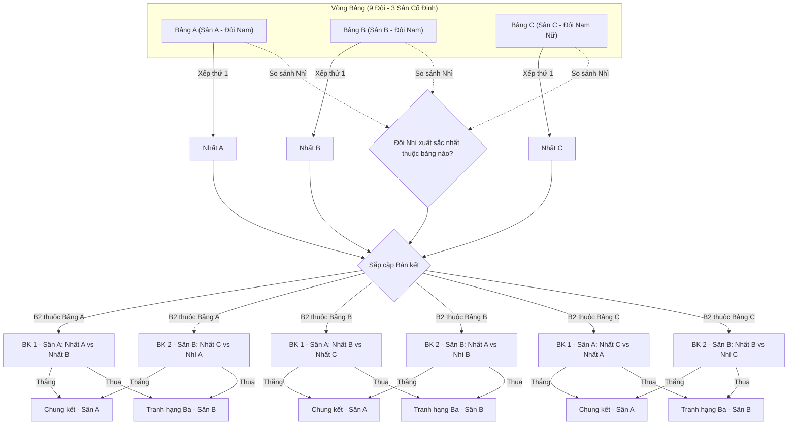

# ĐIỀU LỆ CHI TIẾT GIẢI ĐẤU SEHC PICKLEBALL CUP 2026

---

## CHƯƠNG I: QUY ĐỊNH CHUNG & ĐỐI TƯỢNG THAM GIA

### 1. Mục đích & Ý nghĩa
- Thúc đẩy phong trào tập luyện thể dục thể thao nói chung và bộ môn Pickleball nói riêng trong cộng đồng SEHC.
- Tạo sân chơi lành mạnh, chuyên nghiệp, gắn kết tinh thần đồng đội và giao lưu học hỏi giữa các vận động viên (VĐV).
- Tìm ra nhà vô địch xứng đáng nhất của giải đấu **SEHC Pickleball Cup 2026**.

### 2. Nội dung & Cơ cấu Đội tham gia
- **Tổng số đội tham gia:** 09 đội.
- **Cơ cấu đội hình thực tế:**
  - **06 đôi Nam** (VĐV Nam - Nam).
  - **03 đôi Nam Nữ** (VĐV Nam - Nữ).
- **Nguyên tắc phân chia bảng đấu đảm bảo công bằng:** 
  Để đảm bảo tính công bằng về mặt thể lực và lối chơi, 03 đội Nam Nữ sẽ được xếp vào cùng một bảng đấu riêng biệt là **Bảng C**. 06 đội đôi Nam còn lại sẽ được chia đều vào **Bảng A** và **Bảng B** (mỗi bảng gồm 3 đội đôi Nam).

---

## CHƯƠNG II: KẾT QUẢ BỐC THĂM CHIA BẢNG & SƠ ĐỒ GIẢI ĐẤU

### 1. Danh sách chi tiết các Bảng đấu (Kết quả bốc thăm)

| Group | Team name           | Captain ID | Captain name       | Player2 ID | Player2 name      | Remark     |
| :---: | :---                | :---:      | :---               | :---:      | :---              | :---:      |
| **A1** | Pick Refresh        | 16774200   | Trịnh Minh Hiếu    | 25526023   | Huỳnh Như Thông   | Đôi nam    |
| **A2** | Just Try            | 97130660   | LIM TAEKHWAN       | 12540676   | OH DOOHYUN        | Đôi nam    |
| **A3** | DA Vitamin          | 23522522   | Lê Chí Hoà         | 17792812   | Lê Trịnh Bá Cương | Đôi nam    |
| **B1** | Speed               | 24526022   | Chu Văn Cường      | 24508721   | Nguyễn Bá Quyền   | Đôi nam    |
| **B2** | Platforms T&T       | 16781293   | Nguyễn Thanh Tâm   | 17810224   | Nguyễn Chí Toàn   | Đôi nam    |
| **B3** | VD - FIRST CHAMPION | 22523598   | Trần Hoàn          | 13688095   | Nguyễn Văn Đại    | Đôi nam    |
| **C1** | HOFT                | 24500915   | Lê Thị Hương       | 21507817   | Nguyễn Trọng Tâm  | Đôi nam nữ |
| **C2** | Cook the ball       | 25525970   | Nguyễn Thị Lệ Thuỷ | 25525969   | Đoàn Phạm Hùng    | Đôi nam nữ |
| **C3** | Long Chuyên Toán    | 25507248   | Lê Hoàng Long      | 21513237   | Đoàn Thị Phú Hữu  | Đôi nam nữ |

- **Bảng A & Bảng B:** Dành riêng cho các cặp đôi Nam thi đấu vòng tròn 1 lượt.
- **Bảng C:** Dành riêng cho các cặp đôi Nam Nữ thi đấu vòng tròn 1 lượt.

---

### 2. Sân thi đấu cố định theo Bảng (Vòng bảng)
Để tối ưu hóa thời gian và giúp VĐV làm quen với mặt sân, vòng bảng sẽ được tổ chức thi đấu song song trên **03 sân riêng biệt** với sự phân chia cố định:
- **Bảng A:** Thi đấu cố định tại **SÂN A**.
- **Bảng B:** Thi đấu cố định tại **SÂN B**.
- **Bảng C:** Thi đấu cố định tại **SÂN C**.

---

### 3. Giai đoạn 2: Vòng loại trực tiếp (Knockout Stage)
- **Đối tượng đi tiếp:**
  - **03 đội Nhất bảng** (Nhất A, Nhất B, Nhất C).
  - **01 đội Nhì bảng có thành tích tốt nhất** trong cả 3 bảng (ký hiệu là **B2**).
- **Phân bổ Sân từ vòng Bán kết:** Từ vòng Bán kết trở đi, giải đấu thu hẹp quy mô thi đấu từ 3 sân **rút lại còn 02 sân** (Sân A và Sân B). Sân C sẽ dừng hoạt động thi đấu chính thức.
  - **Sân A:** Sân thi đấu trung tâm chính (Bán kết 1, Chung kết).
  - **Sân B:** Sân thi đấu phụ (Bán kết 2, Tranh hạng Ba).

#### Sơ đồ thi đấu & Phân cặp Bán kết (Tránh gặp lại ở vòng bảng):
Để đảm bảo hai đội đã gặp nhau ở vòng bảng **không tái đấu ngay tại Bán kết**, Ban tổ chức (BTC) áp dụng nguyên tắc phân cặp xoay vòng dựa trên bảng đấu của Đội nhì bảng xuất sắc nhất (**B2**) như sau:

| Trường hợp | Bán kết 1 (BK1) - **SÂN A** | Bán kết 2 (BK2) - **SÂN B** | Ghi chú |
| :--- | :--- | :--- | :--- |
| **B2 thuộc Bảng A** | Nhất A (1A) vs Nhất B (1B) | Nhất C (1C) vs Nhì A (B2) | Không tái đấu vòng bảng |
| **B2 thuộc Bảng B** | Nhất B (1B) vs Nhất C (1C) | Nhất A (1A) vs Nhì B (B2) | Không tái đấu vòng bảng |
| **B2 thuộc Bảng C** | Nhất C (1C) vs Nhất A (1A) | Nhất B (1B) vs Nhì C (B2) | Không tái đấu vòng bảng |

---

## CHƯƠNG III: CÁCH TÍNH ĐIỂM & SO SÁNH THÀNH TÍCH TỐI ƯU

Để đảm bảo tính minh bạch, công bằng và phản ánh chính xác thực lực của các đội trong mô hình bảng đấu 3 đội (nơi rất dễ xảy ra tình trạng "vòng tròn thắng - thua" chéo nhau), BTC quy định cách tính điểm và các tiêu chí so sánh chuyên nghiệp như sau:

### 1. Cách tính điểm trận đấu vòng bảng
- **Trận Thắng:** 2 điểm.
- **Trận Thua:** 1 điểm.
- **Bỏ cuộc (Walkover / Default):** 0 điểm (Đội đối phương được xử thắng với tỷ số set là 3-0 và tỷ số điểm mỗi set là 21-0).

---

### 2. Tiêu chí xếp hạng chi tiết (Tie-breakers tối ưu giảm thiểu bốc thăm)
Nếu có từ 2 đội trở lên bằng điểm nhau sau vòng bảng, thứ tự xếp hạng sẽ được quyết định lần lượt theo các tiêu chí ưu tiên từ trên xuống dưới. Hệ thống 9 bước tự động phân định này giúp hạn chế tối đa việc phải bốc thăm may rủi:

1. **Đối đầu trực tiếp (Head-to-Head):** Kết quả trận đấu giữa 2 đội bằng điểm nhau (chỉ áp dụng nếu chỉ có đúng 2 đội bằng điểm).
2. **Hiệu số Set thắng - thua (Set Difference):** Đội có hiệu số `(Tổng Set thắng - Tổng Set thua)` lớn hơn sẽ xếp trên.
3. **Tỷ lệ phần trăm Set thắng (Set Percentage):** Đội có tỷ lệ % cao hơn xếp trên.
4. **Hiệu số Điểm số thắng - thua (Point Difference):** Đội có hiệu số `(Tổng điểm thắng - Tổng điểm thua)` lớn hơn sẽ xếp trên.
5. **Tỷ lệ phần trăm Điểm số thắng (Point Percentage):** Đội có tỷ lệ % điểm thắng cao hơn sẽ xếp trên.
6. **Tổng số Điểm số thắng thực tế (Total Points Scored):** Đội ghi được nhiều điểm thắng hơn sẽ xếp trên (khuyến khích lối chơi tấn công tích cực).
7. **Tổng số Điểm số thua ít nhất (Least Points Conceded):** Đội để đối thủ ghi ít điểm hơn sẽ xếp trên (ưu tiên lối chơi phòng thủ kỷ luật).
8. **Chỉ số Fair Play (Điểm kỷ luật):** Đội nhận ít lỗi hành vi, cảnh cáo (Warning), thẻ phạt từ Trọng tài chính hơn sẽ xếp trên.
9. **Bốc thăm may rủi (Coin Toss / Draw):** Chỉ thực hiện khi tất cả 8 chỉ số trên hoàn toàn trùng khớp nhau.

#### 💡 Q&A: Hiệu số Set thắng-thua bằng nhau thì Tỷ lệ phần trăm Set thắng có luôn bằng nhau không?
**Trả lời từ Chuyên gia:** **KHÔNG LUÔN BẰNG NHAU.** 
Vì giải đấu thi đấu theo thể thức Best of 5 (Bo5), số set thi đấu trong một trận đấu không cố định (có thể là 3, 4 hoặc 5 set). Do đó, tổng số set đã đấu của các đội có thể khác nhau, dẫn đến tỷ lệ phần trăm thắng khác nhau dù hiệu số bằng nhau.

* **Ví dụ thực tế:**
  Giả sử sau 2 trận vòng bảng, Đội A và Đội B có kết quả như sau:
  * **Đội A:** 
    * Trận 1: Thắng 3 - 0 (đấu 3 set).
    * Trận 2: Thua 2 - 3 (đấu 5 set).
    * **Tổng cộng:** Thắng 5 set, Thua 3 set (Tổng số set đã đấu = 8 set).
    * **Hiệu số Set thắng - thua:** 5 - 3 = **+2**.
    * **Tỷ lệ % Set thắng:** (5 / 8) × 100% = **62.5%**.
  
  * **Đội B:**
    * Trận 1: Thắng 3 - 2 (đấu 5 set).
    * Trận 2: Thắng 3 - 2 (đấu 5 set).
    * **Tổng cộng:** Thắng 6 set, Thua 4 set (Tổng số set đã đấu = 10 set).
    * **Hiệu số Set thắng - thua:** 6 - 4 = **+2**.
    * **Tỷ lệ % Set thắng:** (6 / 10) × 100% = **60.0%**.

* **Kết luận xếp hạng:** Cả hai đội đều có **Hiệu số Set bằng nhau (+2)**, nhưng **Đội A xếp TRÊN Đội B** vì có Tỷ lệ % Set thắng tốt hơn (62.5% so với 60.0%). Chỉ số này là cực kỳ khoa học và công bằng.

---

### 3. Phương thức chọn Đội Nhì bảng xuất sắc nhất (B2) vào Bán kết
Việc so sánh 3 đội xếp thứ Nhì của 3 bảng (Nhì A, Nhì B, Nhì C) sẽ áp dụng trực tiếp 9 tiêu chí xếp hạng tương tự như trên (loại bỏ tiêu chí Đối đầu trực tiếp vì các đội nhì bảng không gặp nhau) để chọn ra đội duy nhất đi tiếp.

---

## CHƯƠNG IV: QUY TẮC THI ĐẤU (GAME RULES)

### 1. Thể thức trận đấu (Match Format)
- **Thể thức:** **Best of 5 (Bo5)** - Đội nào thắng trước **3 Set** sẽ giành chiến thắng chung cuộc.
- **Điểm số mỗi Set:** **21 điểm** (chạm 21).
- **Cách biệt chiến thắng:** Phải thắng cách biệt ít nhất **2 điểm** (ví dụ: 21-19, 22-20). Không giới hạn điểm tối đa (No Cap) để đảm bảo tính kịch tính của thể thao.
- **Đổi sân (Side Change):** Khi một đội đạt **11 điểm** đầu tiên trong set đấu, hai đội bắt buộc đổi sân.

### 2. Thể thức tính điểm trực tiếp (Rally Scoring)
- Bất kỳ đội nào giành chiến thắng trong pha bóng (rally) đều được cộng thêm **1 điểm**, bất kể đội đó giao bóng hay nhận bóng.
- Đội thắng pha bóng trước đó sẽ giành quyền giao bóng cho pha bóng tiếp theo.

### 3. Quy tắc giao bóng theo điểm Chẵn/Lẻ (Even/Odd Service)
- **Không có Người giao bóng thứ hai:** Mỗi đội chỉ có một lượt giao bóng trước khi chuyển giao quyền (Side-out). Ký hiệu số "1" hay "2" bị bãi bỏ.
- **Xác định Người giao bóng:** Dựa trên **Điểm số hiện tại của Đội giao bóng**:
  - Điểm số là **SỐ CHẴN (0, 2, 4... 20)**: Người đứng ở **phần sân bên Phải (Right court)** thực hiện giao bóng.
  - Điểm số là **SỐ LẺ (1, 3, 5... 21)**: Người đứng ở **phần sân bên Trái (Left court)** thực hiện giao bóng.
- **Giữ nguyên vị trí đứng:** VĐV không tự động đổi vị trí trái/phải sau khi ghi điểm (giống tennis). VĐV chỉ đổi vị trí khi chủ động đổi chiến thuật trong thời gian Hội ý (Timeout) hoặc khi đổi sân ở điểm số 11.

---

## CHƯƠNG V: PHƯƠNG THỨC GỌI HỘI Ý (TIMEOUT) PHÙ HỢP

### 1. Hội ý Thường (Standard Timeout)
- **Số lượng:** Mỗi đội được gọi tối đa **02 lần hội ý/set đấu**.
- **Thời lượng:** Mỗi lần kéo dài tối đa **01 phút (60 giây)**.
- **Yêu cầu:** VĐV trên sân yêu cầu với Trọng tài khi bóng chết.

### 2. Hội ý Kỹ thuật (Technical Timeout)
- **Thời điểm:** Tự động kích hoạt khi một đội đạt **11 điểm** trước (trùng thời điểm đổi sân).
- **Thời lượng:** **01 phút (60 giây)**. VĐV tranh thủ lau mồ hôi, tiếp nước và trao đổi nhanh với HLV/đồng đội.

### 3. Hội ý Y tế (Medical Timeout)
- **Số lượng:** Tối đa **01 lần/VĐV/trận đấu** khi có chấn thương thực tế (chuột rút, căng cơ...).
- **Thời lượng:** Tối đa **03 - 05 phút** chăm sóc y tế. Trọng tài chính là người quyết định thời gian dừng dựa trên tình hình thực tế. Quá thời gian quy định nếu không thể thi đấu, đội đó bị xử thua (Default).

---

## CHƯƠNG VI: QUY ĐỊNH TRANG PHỤC & DỤNG CỤ THI ĐẤU

### 1. Trang phục thi đấu (Attire)
- **Trang phục:** Vận động viên phải mặc trang phục thể thao gọn nhẹ, lịch sự, phù hợp với thuần phong mỹ tục và hoạt động vận động cường độ cao.
- **Giày:** Phải đi giày thể thao chuyên dụng (court shoes/running shoes) có đế cao su mềm, độ bám tốt, sạch sẽ và không gây xước hoặc để lại vệt đen trên mặt sân.
- **Thiết bị hỗ trợ an toàn:** VĐV được tự do sử dụng các trang thiết bị hỗ trợ bảo vệ khớp và cơ như: băng cổ tay, băng đầu gối, băng trán, đai bảo vệ lưng, v.v.
- **Quy định về phụ kiện nguy hiểm:** **Tuyệt đối không mang trang sức, đồng hồ cứng, vòng cổ, khuyên tai sắc nhọn...** trong lúc thi đấu để tránh gây chấn thương cho bản thân và bạn chơi. *Ngoại trừ: Đồng hồ thông minh đo chỉ số sức khỏe chuyên dụng có thiết kế dây silicon ôm sát, không có cạnh sắc nhọn.*

### 2. Vợt & Bóng thi đấu
- **Vợt thi đấu:** VĐV tự trang bị vợt Pickleball tiêu chuẩn theo đúng quy chuẩn kỹ thuật. Không được phép sử dụng các loại vợt tự chế, vợt dán thêm bề mặt nhám vượt quy định làm thay đổi quỹ đạo xoáy của bóng.
- **Bóng thi đấu:** Bóng thi đấu chính thức đạt chuẩn chuyên nghiệp sẽ do **Ban Tổ Chức hỗ trợ và cung cấp** hoàn toàn cho tất cả các trận đấu trong giải.

---

## CHƯƠNG VII: KHIẾU NẠI & GIẢI QUYẾT TRANH CHẤP

Nhằm đảm bảo giải đấu diễn ra công bằng, minh bạch và giữ vững tinh thần thể thao cao thượng, quy trình giải quyết khiếu nại được quy định nghiêm ngặt như sau:

### 1. Quyết định của Trọng tài là cuối cùng
- Mọi tình huống xảy ra trên sân (như xác định bóng trong/ngoài sân - in/out, lỗi chạm lưới, lỗi đứng sai vị trí giao bóng, lỗi vùng Kitchen...) sẽ do **Trọng tài chính điều khiển trận đấu đó quan sát và đưa ra quyết định cuối cùng**. Tất cả các VĐV phải tuyệt đối tôn trọng và chấp hành quyết định của Trọng tài.

### 2. Không chấp nhận khiếu nại sau trận đấu
- Ban Tổ Chức **tuyệt đối không tiếp nhận và giải quyết bất kỳ khiếu nại nào liên quan đến kết quả trận đấu sau khi trận đấu đã kết thúc** (sau khi hai đội đã ký vào biên bản xác nhận kết quả trận đấu). Mọi thắc mắc hoặc ý kiến phải được phản hồi ngay lúc tình huống xảy ra với Trọng tài chính trước khi bóng tiếp theo được giao.

### 3. Giải đấu không áp dụng VAR (Không dùng video tự quay)
- Giải đấu SEHC Pickleball Cup 2026 là giải đấu phong trào chuyên nghiệp, **không hỗ trợ công nghệ VAR** (Trợ lý trọng tài video).
- **BTC tuyệt đối không sử dụng các nguồn video do cá nhân, đội thi đấu hoặc khán giả tự quay bằng điện thoại/camera cá nhân** để làm cơ sở khiếu nại, thay đổi quyết định của Trọng tài hoặc phân định tranh chấp. Kết quả dựa hoàn toàn vào sự quan sát trực tiếp của tổ trọng tài điều khiển trận đấu.

---

## CHƯƠNG VIII: LỊCH THI ĐẤU CHI TIẾT TRONG BUỔI SÁNG (GÓI GỌN TRONG 1 NGÀY)

Giải đấu được thiết kế lịch trình tối ưu thi đấu **gói gọn và hoàn thành toàn bộ trong một buổi sáng** (từ 7h00 đến khoảng 12h20). Giữa các lượt trận vòng bảng đều được bố trí **10 phút nghỉ ngơi (Break)** nhằm giúp các vận động viên tiếp nước, hồi phục thể lực và tránh việc một đội phải thi đấu liên tục 2 trận không nghỉ:

### 1. Bảng tiến trình trận đấu chi tiết (Có tên đội cụ thể)

| Mốc Thời gian | SÂN A (Bảng A - Đôi Nam) | SÂN B (Bảng B - Đôi Nam) | SÂN C (Bảng C - Đôi Nam Nữ) | Ghi chú |
| :---: | :--- | :--- | :--- | :--- |
| **7h00 - 8h00** | **Tập trung toàn bộ 9 đội & Điểm danh (Roll-call)** Làm thủ tục điểm danh, phát bóng, khởi động tự do trên các sân. | **Khu vực kỹ thuật** | Ban Tổ Chức điểm danh và kiểm tra trang phục/vợt. |
| **8h00 - 8h35** | **Trận 1:** **Pick Refresh** vs **Just Try** | **Trận 1:** **Speed** vs **Platforms T&T** | **Trận 1:** **HOFT** vs **Cook the ball** | • Thi đấu đồng thời trên 3 sân. • Trung bình 30-35 phút/trận. |
| **8h35 - 8h45** *(10 phút)* | **Nghỉ giải lao giữa các trận (Break 1):** Các đội nghỉ ngơi 10 phút, tiếp nước và hồi phục thể lực; tránh tình trạng đội thi đấu liên tục 2 trận. | **Khu vực kỹ thuật** | VĐV giãn cơ, chuẩn bị cho lượt trận thứ 2. |
| **8h45 - 9h20** | **Trận 2:** **Just Try** vs **DA Vitamin** | **Trận 2:** **Platforms T&T** vs **VD - FIRST CHAMPION** | **Trận 2:** **Cook the ball** vs **Long Chuyên Toán** | • Vòng bảng lượt trận thứ hai. • Các đội đổi ca nhanh chóng. |
| **9h20 - 9h30** *(10 phút)* | **Nghỉ giải lao giữa các trận (Break 2):** Các đội nghỉ ngơi 10 phút, tiếp nước và chuẩn bị thể lực cho lượt trận quyết định vòng bảng. | **Khu vực kỹ thuật** | VĐV giãn cơ, sẵn sàng cho lượt trận cuối bảng. |
| **9h30 - 10h05** | **Trận 3:** **Pick Refresh** vs **DA Vitamin** | **Trận 3:** **Speed** vs **VD - FIRST CHAMPION** | **Trận 3:** **HOFT** vs **Long Chuyên Toán** | • Hoàn thành toàn bộ vòng bảng. • Xác định xong kết quả các bảng. |
| **10h05 - 10h20** *(15 phút)* | **Nghỉ giải lao & Ban Tổ Chức tổng hợp chỉ số phụ:** BTC tính điểm, đối chiếu các tie-breakers tìm ra 3 đội Nhất bảng & 1 đội Nhì xuất sắc nhất (B2), công bố cặp đấu Bán kết dựa trên nguyên tắc xoay vòng (tránh gặp lại ở vòng bảng). | **Khu vực Ban Tổ Chức** | VĐV tranh thủ tiếp nước, hồi phục thể lực trước vòng Bán kết. |
| **10h20 - 11h00** | **Trận BÁN KẾT 1 (BK1):** **Đội Nhất A** vs **Đội Nhất B** *(Ví dụ cho trường hợp B2 đến từ bảng A)* | **Trận BÁN KẾT 2 (BK2):** **Đội Nhất C** vs **Đội Nhì xuất sắc nhất (B2)** *(Ví dụ cho trường hợp B2 đến từ bảng A)* | ***Dừng hoạt động thi đấu*** | • **Rút lại chỉ thi đấu trên 2 sân** (Sân A và Sân B). • Cặp đấu xếp chính xác theo bảng phân cặp Chương II. |
| **11h00 - 11h15** *(15 phút)* | **Nghỉ giải lao ngắn trước lượt trận chung cuộc** | **Khu vực kỹ thuật** | Giúp các đội vừa thi đấu Bán kết có thời gian hồi sức. |
| **11h15 - 11h55** | **Trận CHUNG KẾT (Tranh Nhất - Nhì):** **Thắng Bán kết 1** vs **Thắng Bán kết 2** | **Trận TRANH HẠNG BA:** **Thua Bán kết 1** vs **Thua Bán kết 2** | ***Dừng hoạt động thi đấu*** | • Trận Chung kết tranh ngôi Vô địch diễn ra tại Sân A trung tâm. |
| **11h55 - 12h20** | **Tổng kết ngày thi đấu:** Công bố bế mạc ngày thi đấu, dọn dẹp sân bãi và tiến hành công tác kỹ thuật khác. | **Toàn bộ sân đấu** | Các đội nhận biên bản tổng kết kết quả thi đấu từ BTC. |

- *Lưu ý linh động:* Lịch trình buổi sáng được tính toán chặt chẽ cho 1 ngày thi đấu trọn vẹn. Trong trường hợp các set đấu diễn ra quá căng thẳng và kéo dài quá 12h20, BTC sẽ sử dụng khung giờ nghỉ trưa dự phòng từ **12h20 đến 13h20** và sẽ tổ chức thi đấu nốt các trận loại trực tiếp vào đầu giờ chiều từ **13h20**.

---

### 2. Địa điểm & Lễ trao giải chính thức
- **Địa điểm thi đấu cụ thể:** Sẽ được BTC gửi thông báo chính thức sau bằng văn bản hoặc email đến từng đội trưởng.
- **Ngày thi đấu chính thức:** Chủ Nhật, ngày 15/11/2026 (bắt đầu từ 08h00 sáng).
- **Quy chế Trao giải:** 
  * Để tạo tính gắn kết tập thể lớn hơn, **Lễ trao giải chính thức** (Trao Cúp vô địch, Huy chương Vàng, Bạc, Đồng và phần thưởng) sẽ **không tổ chức cùng ngày thi đấu**.
  * Các giải thưởng sẽ được vinh danh và trao tặng trang trọng ngay trong **Lễ bế mạc Hội thao SEHC 2026** (diễn ra vào một ngày khác theo lịch chung của Tổng Hội thao SEHC).

### 3. Kỷ luật về thời gian có mặt
- Các đội trễ giờ thi đấu quá **10 phút** so với lịch công bố của BTC (sau khi đã phát loa gọi tên 3 lần) mà không có lý do chính đáng được thông báo trước tối thiểu 30 phút sẽ bị xử thua cuộc (Default) trận đấu đó với tỷ số 0-3 (điểm các set là 0-21).

---
**BAN TỔ CHỨC GIẢI ĐẤU SEHC PICKLEBALL CUP 2026**  
*Trưởng Ban Tổ Chức*  
*(Đã ký)*
