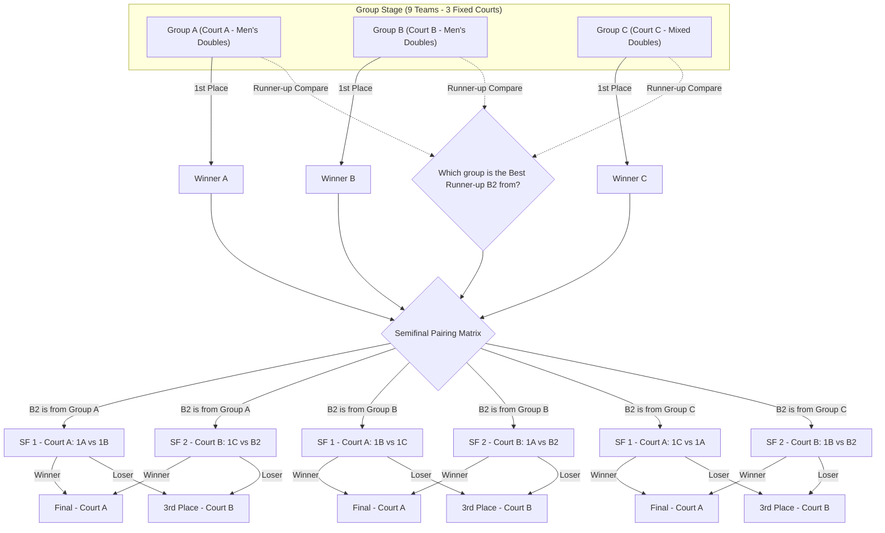

# DETAILED TOURNAMENT REGULATIONS: SEHC PICKLEBALL CUP 2026

---

## CHAPTER I: GENERAL REGULATIONS & ELIGIBILITY

### 1. Purpose & Significance
- To promote the physical fitness movement in general and Pickleball in particular within the SEHC community.
- To create a healthy, professional playground that fosters team spirit, sportsmanship, and mutual learning among athletes.
- To determine the most deserving champion of the **SEHC Pickleball Cup 2026**.

### 2. Competition Content & Team Structure
- **Total participating teams:** 09 teams.
- **Actual team structure:**
  - **06 Men's Doubles teams** (Male - Male athletes).
  - **03 Mixed Doubles teams** (Male - Female athletes).
- **Fairness-based Group Allocation Principle:** 
  To ensure absolute fairness in terms of physical strength and playstyle dynamics, the 03 Mixed Doubles teams will be grouped together into a dedicated group: **Group C**. The remaining 06 Men's Doubles teams will be equally divided into **Group A** and **Group B** (each consisting of 3 Men's Doubles teams).

---

## CHAPTER II: DRAW RESULTS & TOURNAMENT BRACKET

### 1. Detailed Group Allocation (Draw Results)

| Group | Team name           | Captain ID | Captain name       | Player2 ID | Player2 name      | Remark     |
| :---: | :---                | :---:      | :---               | :---:      | :---              | :---:      |
| **A1** | Pick Refresh        | 16774200   | Trịnh Minh Hiếu    | 25526023   | Huỳnh Như Thông   | Men's Doubles |
| **A2** | Just Try            | 97130660   | LIM TAEKHWAN       | 12540676   | OH DOOHYUN        | Men's Doubles |
| **A3** | DA Vitamin          | 23522522   | Lê Chí Hoà         | 17792812   | Lê Trịnh Bá Cương | Men's Doubles |
| **B1** | Speed               | 24526022   | Chu Văn Cường      | 24508721   | Nguyễn Bá Quyền   | Men's Doubles |
| **B2** | Platforms T&T       | 16781293   | Nguyễn Thanh Tâm   | 17810224   | Nguyễn Chí Toàn   | Men's Doubles |
| **B3** | VD - FIRST CHAMPION | 22523598   | Trần Hoàn          | 13688095   | Nguyễn Văn Đại    | Men's Doubles |
| **C1** | HOFT                | 24500915   | Lê Thị Hương       | 21507817   | Nguyễn Trọng Tâm  | Mixed Doubles |
| **C2** | Cook the ball       | 25525970   | Nguyễn Thị Lệ Thuỷ | 25525969   | Đoàn Phạm Hùng    | Mixed Doubles |
| **C3** | Long Chuyên Toán    | 25507248   | Lê Hoàng Long      | 21513237   | Đoàn Thị Phú Hữu  | Mixed Doubles |

- **Group A & Group B:** Exclusively for Men's Doubles, playing single round-robin.
- **Group C:** Exclusively for Mixed Doubles, playing single round-robin.

---

### 2. Fixed Courts by Group (Group Stage)
To optimize schedule flow and allow VĐVs to adapt to court conditions, the group stage matches will run concurrently on **03 dedicated courts**:
- **Group A:** Exclusively plays on **COURT A**.
- **Group B:** Exclusively plays on **COURT B**.
- **Group C:** Exclusively plays on **COURT C**.

---

### 3. Stage 2: Vòng loại trực tiếp (Knockout Stage)
- **Advancing Teams:**
  - **03 Group Winners** (Winner A, Winner B, Winner C).
  - **01 Best Group Runner-up** across all three groups (denoted as **B2**).
- **Knockout Court Allocation:** From the Semifinals onwards, the competition scales down from 3 courts to **02 active courts** (Court A and Court B). Court C will be closed.
  - **Court A:** Main Central Court (Semifinal 1, Finals).
  - **Court B:** Secondary Court (Semifinal 2, 3rd Place Match).

#### Semifinal Matchups & Rematch Prevention:
To guarantee that two teams that met in the group stage **do not replay each other in the Semifinals**, the Organizing Committee (BTC) implements a rotation coupling matrix based on the group origin of the Best Runner-up (**B2**):

| Case Scenario | Semifinal 1 (SF1) - **COURT A** | Semifinal 2 (SF2) - **COURT B** | Remarks |
| :--- | :--- | :--- | :--- |
| **B2 is from Group A** | Winner A (1A) vs Winner B (1B) | Winner C (1C) vs Runner-up A (B2) | No group rematch |
| **B2 is from Group B** | Winner B (1B) vs Winner C (1C) | Winner A (1A) vs Runner-up B (B2) | No group rematch |
| **B2 is from Group C** | Winner C (1C) vs Winner A (1A) | Winner B (1B) vs Runner-up C (B2) | No group rematch |

---

## CHAPTER III: SCORING SYSTEM & OPTIMAL TIE-BREAKING

To ensure absolute transparency and sporting fairness in a 3-team group structure (where head-to-head loop ties often occur), the following professional tie-breaking procedures apply:

### 1. Group Match Point Allocation
- **Match Win:** 2 points.
- **Match Loss:** 1 point.
- **Default/Forfeit (Walkover):** 0 points (The opposing team is awarded a 3-0 set win, with a 21-0 point score for each set).

---

### 2. Group Standings Tie-Breakers (Sequential Steps)
If two or more teams have identical standings points after the Group Stage, their final ranking will be resolved by applying the following 9 criteria in sequence to minimize any coin-toss occurrence:

1. **Head-to-Head (H2H):** Match result between the tied teams (only applies if exactly 2 teams are tied).
2. **Set Difference:** Team with the highest `(Total Sets Won - Total Sets Lost)` in all group matches ranks higher.
3. **Set Percentage:** Team with the higher percentage of sets won ranks higher.
4. **Point Difference:** Team with the highest `(Total Points Scored - Total Points Conceded)` in all group matches ranks higher.
5. **Point Percentage:** Team with the higher percentage of points won ranks higher.
6. **Total Points Scored:** Team with more total scored points ranks higher (rewarding aggressive attacking play).
7. **Least Points Conceded:** Team with fewer total conceded points ranks higher (rewarding disciplined defense).
8. **Fair Play Index:** Team with fewer behavioral warnings or penalty points issued by the Chair Referee ranks higher.
9. **Coin Toss / Draw:** Only conducted if all the above 8 parameters are identical.

#### 💡 Q&A: Does an equal Set Difference always mean an equal Set Percentage?
**Expert Explanation:** **NO, NOT ALWAYS.**
Since matches are played in Best of 5 (Bo5) format, the total number of sets played in any match can vary from 3 to 5 sets. Consequently, the total sets played by each team can differ, creating different win percentages despite an identical set difference.

* **Real Scenario Example:**
  Suppose Team A and Team B have the following group stage records:
  * **Team A:** 
    * Match 1: Wins 3 - 0 (3 sets played).
    * Match 2: Loses 2 - 3 (5 sets played).
    * **Totals:** 5 Sets Won, 3 Sets Lost (Total sets played = 8).
    * **Set Difference:** 5 - 3 = **+2**.
    * **Set Percentage:** (5 / 8) × 100% = **62.5%**.

    * **Team B:**
    * Match 1: Won 3 - 2 (5 sets played).
    * Match 2: Won 3 - 2 (5 sets played).
    * **Total:** Won 6 sets, Lost 4 sets (Total sets played = 10 sets).
    * **Set Difference:** 6 - 4 = **+2**.
    * **Set Percentage:** (6 / 10) × 100% = **60.0%**.

* **Standings Result:** Despite both teams having a **Set Difference of +2**, **Team A ranks ABOVE Team B** due to a superior Set Percentage (62.5% vs 60.0%). This metric is scientifically fair and precise.

---

### 3. Selection of the Best Runner-up (B2) for Semifinals
Comparing the runner-up teams across Group A, B, and C will utilize the exact 9 tie-breaking criteria listed above (excluding Head-to-Head since they didn't play each other) to select the single advancing team.

---

## CHAPTER IV: GAME RULES

### 1. Match Format
- **Format:** **Best of 5 (Bo5)** - First team to win **3 Sets** wins the match.
- **Set Points:** **21 points** (first to 21).
- **Win Margin:** Must win by a **2-point margin** (e.g., 21-19, 22-20). No scoring cap (No Cap) is applied.
- **Side Change:** As soon as any team reaches **11 points** in a set, teams must switch sides.

### 2. Rally Scoring System
- A point is scored on **every single rally (Rally Scoring)**, regardless of which team is serving.
- The team that wins the rally scores a point and secures the right to serve for the next rally.

### 3. Even/Odd Court Serving Rule
- **No Second Server:** Each team has only one service turn before a side-out is called. Kicking out the old "2nd server" notation.
- **Determining the Server:** Based on the **current score of the Serving Team**:
  - Score is **EVEN (0, 2, 4... 20)**: The player standing on the **Right Court (Even Court)** serves.
  - Score is **ODD (1, 3, 5... 21)**: The player standing on the **Left Court (Odd Court)** serves.
- **Fixed Player Positions:** Players do not swap left/right positions after winning a point on their own serve. Players only switch positions if they choose to do so strategically during a Timeout or at the 11-point court switch.

---

## CHAPTER V: TIMEOUT PROTOCOLS

### 1. Standard Timeout
- **Limit:** Each team is allowed a maximum of **02 standard timeouts per set**.
- **Duration:** Each timeout lasts a maximum of **01 minute (60 seconds)**.
- **Request:** Must be requested by VĐV on court during a dead ball.

### 2. Technical Timeout
- **Timing:** Automatically activated when any team reaches **11 points** (coinciding with side changes).
- **Duration:** **01 minute (60 seconds)**. Players hydrate and discuss tactics with coaches.

### 3. Medical Timeout
- **Limit:** Maximum of **01 medical timeout per player per match** for actual injuries.
- **Duration:** Up to **03 - 05 minutes**. The Chair Referee makes the final decision. If unable to play after 5 mins, a Default/Default is recorded.

---

## CHAPTER VI: ATTIRE & EQUIPMENT REGULATIONS

### 1. Attire & Footwear
- **Attire:** Players must wear neat, polite, sport-appropriate clothing suitable for high-intensity movement.
- **Footwear:** Specialized non-marking rubber court/running shoes are mandatory to protect the court surface.
- **Safety Equipment:** Players are allowed to wear support gear (knee sleeves, wristbands, headbands, back braces, etc.).
- **Dangerous Accessories:** **Strictly no hard jewelry, watches, necklaces, or sharp earrings** during matches. *Exception: Flat silicone-band health trackers with no sharp edges.*

### 2. Paddles & Balls
- **Paddles:** VĐVs equip their own standard paddles (recreational tournament, USAPA certification not required). Customized high-friction adhesive modifiers are strictly banned.
- **Tournament Balls:** Professional tournament-grade balls will be **fully sponsored and supplied by the Organizing Committee**.

---

## CHAPTER VII: COMPLAINTS & DISPUTE RESOLUTION

### 1. Referee's Decision is Final
- All on-court calls (in/out, net touches, foot faults, kitchen faults) made by the **assigned Chair Referee are final and absolute**. All VĐVs must show respect and comply.

### 2. No Post-Match Complaints
- The Organizing Committee **will not accept or resolve any complaints regarding match results once the match has concluded and the scoresheet is signed**. Any objections must be raised with the Referee immediately when the situation occurs before the next service.

### 3. No VAR (No Personal Video Replay)
- This is a professional-amateur tournament, and **VAR (Video Assistant Referee) technology is not supported**.
- **BTC strictly prohibits using personal smartphone/camera video recordings** to appeal or challenge any referee decisions.

---

## CHAPTER VIII: DETAILED MORNING SCHEDULE (FINISHED IN ONE DAY)

The tournament is optimized to **finish completely within one morning** (7:00 AM to approx. 12:20 PM). Dedicated **10-minute inter-match breaks** are scheduled between group stage rounds to allow athletes to hydrate, recover, and avoid any team playing 2 consecutive matches without rest:

### 1. Detailed Progress Schedule (With exact Team Names)

| Time Frame | COURT A (Group A - Men's Doubles) | COURT B (Group B - Men's Doubles) | COURT C (Group C - Mixed Doubles) | Remarks |
| :---: | :--- | :--- | :--- | :--- |
| **7:00 AM - 8:00 AM** | **Gathering & Roll-Call** Athlete check-in, ball distribution, and free warm-up on courts. | **Technical Area** | All 9 teams must report on time. |
| **8:00 AM - 8:35 AM** | **Match 1:** **Pick Refresh** vs **Just Try** | **Match 1:** **Speed** vs **Platforms T&T** | **Match 1:** **HOFT** vs **Cook the ball** | • Runs concurrently on 3 courts. • Avg. 30-35 mins per match. |
| **8:35 AM - 8:45 AM** *(10 mins)* | **Inter-Match Break (Break 1):** 10-minute rest and hydration break to prevent teams from playing 2 consecutive matches. | **Technical Area** | Athletes stretch and prepare for Round 2. |
| **8:45 AM - 9:20 AM** | **Match 2:** **Just Try** vs **DA Vitamin** | **Match 2:** **Platforms T&T** vs **VD - FIRST CHAMPION** | **Match 2:** **Cook the ball** vs **Long Chuyên Toán** | • Group Stage Matchday Round 2. • Swift court transitions. |
| **9:20 AM - 9:30 AM** *(10 mins)* | **Inter-Match Break (Break 2):** 10-minute rest and hydration break before decisive final group stage matches. | **Technical Area** | Athletes stretch and prepare for final round. |
| **9:30 AM - 10:05 AM** | **Match 3:** **Pick Refresh** vs **DA Vitamin** | **Match 3:** **Speed** vs **VD - FIRST CHAMPION** | **Match 3:** **HOFT** vs **Long Chuyên Toán** | • Group stage matches completed. • Final standings determined. |
| **10:05 AM - 10:20 AM** *(15 mins)* | **Break & Score Compilation:** BTC calculates scores and secondary tie-breakers to announce the 3 Group Winners and 1 Best Runner-up (B2). | **BTC Desk** | Players hydrate and prepare for Semifinals. |
| **10:20 AM - 11:00 AM** | **SEMIFINAL 1 (SF1):** **Group Winner A** vs **Group Winner B** *(Example for B2 coming from Group A)* | **SEMIFINAL 2 (SF2):** **Group Winner C** vs **Best Runner-up (B2)** *(Example for B2 coming from Group A)* | ***Court closed*** | • **Downscaled to 02 active courts** (Court A and Court B). • Match pairings set by Chapter II matrix. |
| **11:00 AM - 11:15 AM** *(15 mins)* | **Short break before final matches** | **Technical Area** | Gives athletes time to recover. |
| **11:15 AM - 11:55 AM** | **FINAL MATCH (1st - 2nd place):** **Winner SF1** vs **Winner SF2** | **3RD PLACE MATCH:** **Loser SF1** vs **Loser SF2** | ***Court closed*** | • The gold medal match runs on central Court A. |
| **11:55 AM - 12:20 PM** | **Closing of Matchday:** Scoresheet validation, court cleanup, and official matchday wrap-up. | **All Courts** | Teams receive technical summaries from BTC. |

---

### 2. Venue & Official Award Ceremony
- **Tournament Venue:** Will be officially notified via email/text to team captains.
- **Match Date:** Sunday, November 15, 2026 (starting from 08:00 AM).
- **Award Ceremony Protocol:** 
  * To maximize community engagement, **the official Award Ceremony (trophy, medals, prizes) will not be held on the matchday**.
  * Winners will be honored during the **Official Closing Ceremony of the SEHC Olympic Games 2026** (held on a different date per the general Olympic schedule).

### 3. Attendance Discipline
- Teams arriving late by more than **10 minutes** from the scheduled time (after being announced on PA 3 times) without prior valid notice of at least 30 minutes will forfeit the match (Default 0-3 sets, 0-21 points per set).

---
**ORGANIZING COMMITTEE OF SEHC OLYMPIC GAMES 2026**  
*Head of Organizing Committee*  
*(Signed)*
